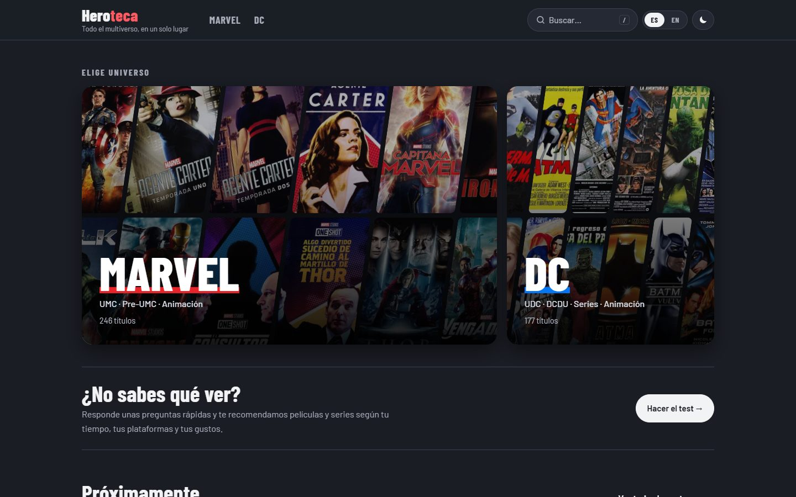
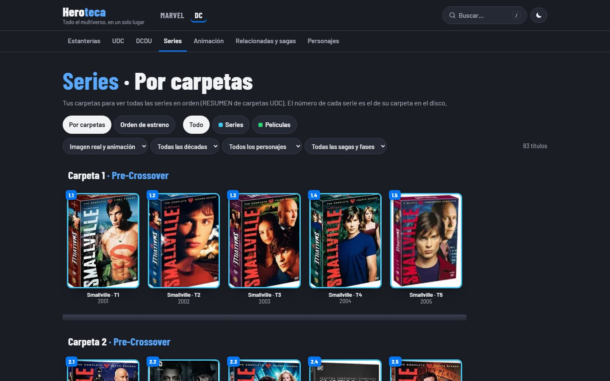
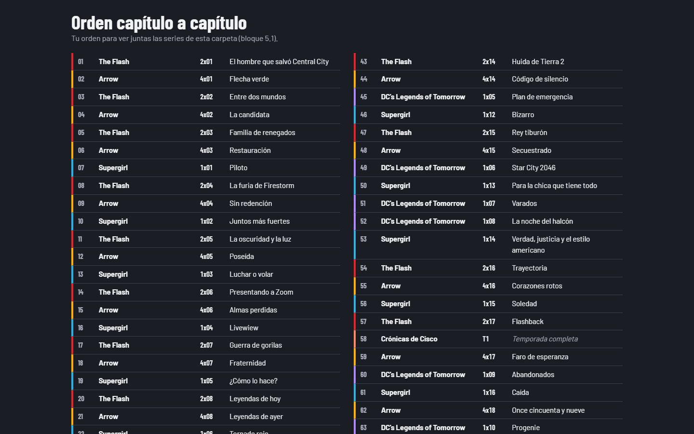
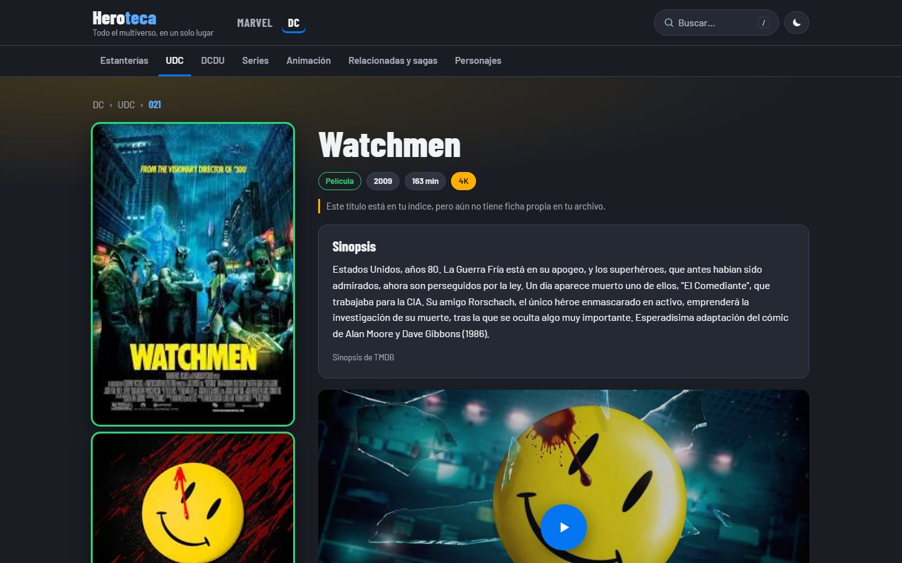
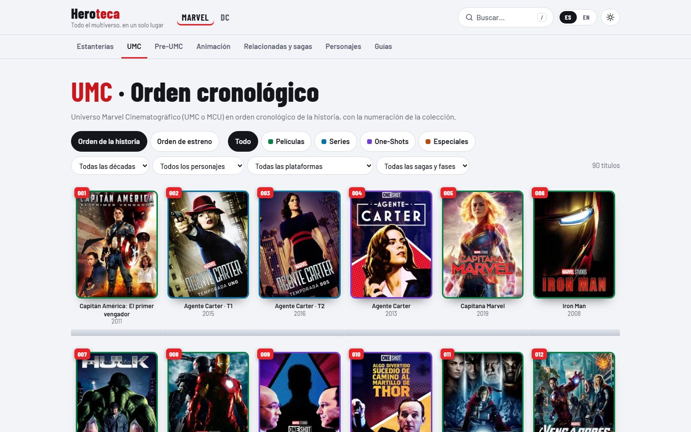

# Heroteca

**Enciclopedia personal de películas, series y animación de Marvel y DC, construida a partir de un archivo real de documentos Word y PowerPoint.**

🔗 **[heroteca.vercel.app](https://heroteca.vercel.app)** · versión en inglés: **[heroteca.vercel.app/en/](https://heroteca.vercel.app/en/)**



Proyecto de fans, sin ánimo de lucro y no oficial.

---

## Qué es

Heroteca nace de un archivo personal: años de colección de superhéroes catalogada en documentos de Word y PowerPoint:
- fichas técnicas;
- índices numerados;
- estanterías con carátulas;
- y, para las series de DC, un orden de visionado **capítulo a capítulo** que alterna Arrow, Flash, Supergirl y Legends.

La web convierte ese archivo en algo navegable y respeta **su propia organización**: no la de una base de datos genérica. Así:
- en Marvel se mantiene su numeración cronológica del UMC (001-100);
- en DC, la estructura de carpetas del disco duro donde está la colección.

## Características

- **423 fichas** (246 de Marvel, 177 de DC), **171 personajes**, **42 sagas y agrupaciones**.
- **Estanterías** con la numeración original y orden alternable (historia o estreno), leyenda de colores y **vista de lista** compacta; en móvil, los filtros se agrupan en un botón.
- **Orden por carpetas** para las series de DC (Pre-Crossover, Crossover…), con páginas que muestran el orden de visionado capítulo a capítulo entre varias series.
- **Filtros** por tipo, década, personaje y saga; **búsqueda instantánea** (atajo `/`) que también encuentra títulos originales y alternativos.
- **Fichas completas**: datos del archivo original, completados con sinopsis, reparto, carteles y tráileres de TMDB. Cada dato de TMDB queda marcado. La imagen principal es el cartel oficial y cada ficha muestra también la carátula de la edición de la colección.
- **Dónde ver**: plataformas de suscripción, alquiler y compra de cada título (España en la versión española,
  EE. UU. en la inglesa), con datos de JustWatch que se **actualizan solos cada semana**.
- **Próximamente**: calendario de los próximos estrenos de Marvel y DC (películas, series y temporadas nuevas) y de las
  series en emisión, con cuenta atrás y filtro por universo. Datos de TMDB que se **actualizan solos cada semana**.
- **Guías de visionado**: orden del UMC (cronológico y de estreno), películas de DC y Arrowverso capítulo a capítulo.
- **Bilingüe (español e inglés)**: interfaz, datos (títulos, sinopsis, capítulos y carteles en inglés) y direcciones
  traducidas (`/en/marvel/captain-america-the-first-avenger/`), con `hreflang` para los buscadores.
- **Spoilers ocultos** hasta pulsarlos, aviso de escenas post-créditos y "ver antes / ver después".
- **Modo claro y oscuro** (sigue al sistema y recuerda la elección), adaptada a móvil; las estanterías recuerdan
  los filtros al volver desde una ficha.

| | |
|---|---|
|  |  |
|  |  |

## Cómo está hecha

### Del documento a la web

```
Word / PowerPoint ──► scripts de Python ──► Markdown + YAML ──► Astro ──► HTML estático
  (archivo original)   (extracción y           (contenido/,          (validación
                        emparejado con TMDB)     revisable a mano)     con Zod)
```

1. **Extracción.** Los scripts leen las copias de los documentos con `python-docx` y `python-pptx`. Recogen tablas, cuadros de texto, carátulas e incluso la **calidad de cada copia**, que en los originales es una imagen (insignias 720p, 1080p, 4K, AVI) y se identifica por su huella SHA-1.
2. **Emparejado con TMDB.** Cada título se busca en TMDB y se acepta con un umbral de confianza. Los casos dudosos van a una lista de revisión y a un archivo de correcciones manuales.
3. **Contenido.** Cada ficha es un archivo Markdown con cabecera YAML, legible y editable a mano. Astro valida todo con esquemas Zod y comprobaciones de integridad: referencias rotas, números duplicados, secciones inexistentes. Si un dato está mal, la compilación falla e indica el archivo y el campo.
4. **Compilación.** TMDB solo se consulta al sincronizar, nunca desde el navegador. Los datos se guardan en un JSON compacto dentro del repositorio, así que la web publicada no necesita claves ni hace llamadas externas.
5. **Actualización semanal.** Una tarea de GitHub Actions pide cada lunes los datos de «dónde ver» y los sube al repositorio; Vercel vuelve a publicar la web sola. La clave de TMDB está guardada como secreto de GitHub, nunca en el código.

### Dos idiomas sin duplicar páginas

Cada página vive una sola vez en `src/pages/[...idioma]/` y genera su versión española y la inglesa. Los textos fijos
están en un diccionario (`src/i18n/textos.ts`) y los datos en inglés salen de TMDB. Las direcciones inglesas se
**calculan a partir de los datos** (`src/i18n/rutas.ts`: título inglés de cada ficha, `idEn` de las secciones,
`nombreEn` de personajes y sagas), así que no hay ninguna tabla que mantener. En el código los enlaces se escriben
en español y una integración de Astro los traduce al compilar las páginas inglesas.

### Decisiones

- **Los documentos mandan.** TMDB solo rellena lo que falta y nunca sobrescribe. Las erratas evidentes se corrigen dejando una nota con el texto original.
- **Web 100 % estática** (Astro, sin framework de cliente). Unas pocas islas de JavaScript sin dependencias: buscador, filtros, tema, spoilers y la fachada del tráiler. El tráiler usa `youtube-nocookie` y solo se carga al pulsar.
- **Preparada para crecer.** Añadir un universo nuevo es crear un archivo YAML; las rutas, la navegación y la portada se generan solas.
- **Coste cero.** Vercel (plan gratuito), TMDB (API gratuita), GitHub Actions, Cloudflare Web Analytics (estadísticas sin cookies), tipografías autoalojadas con Fontsource.

### Tecnología

**Astro 7** · TypeScript · Content Collections + Zod · CSS sin frameworks · **Python** (python-docx, python-pptx, PyMuPDF, Pillow) · API de **TMDB** y datos de **JustWatch** · GitHub Actions · Vercel

### Calidad

| Lighthouse | Puntuación |
|---|---|
| Accesibilidad | 100 |
| SEO | 100 |
| Buenas prácticas | 100 |
| Rendimiento | 90–99 |

- Contraste AA en ambos modos, navegación por teclado y foco visible, respeto a `prefers-reduced-motion`.
- Datos estructurados schema.org (`Movie`, `TVSeries`, `TVSeason`, `ItemList`, `BreadcrumbList`), mapa del sitio y `hreflang`.
- Comprobación de los ~47.000 enlaces internos y de las 1.340 parejas de idioma en cada cambio importante.

## Estructura

```
contenido/   Fichas, personajes, sagas, universos y órdenes de visionado (Markdown + YAML)
datos/       Datos de TMDB ya procesados y correcciones manuales
scripts/     Extracción de documentos, emparejado con TMDB y generación de fichas (Python)
src/         Web en Astro: páginas, componentes, esquema, lógica de orden e idiomas (src/i18n)
.github/     Tarea semanal que actualiza «dónde ver»
docs/        Manual de uso y capturas
```

```bash
npm install
npm run dev     # http://localhost:4321
npm run build   # genera la web y valida todos los datos
```

El manual completo (añadir fichas, regenerar desde los documentos, sincronizar TMDB) está en [`docs/MANUAL.md`](docs/MANUAL.md).

## Créditos y aviso legal

Proyecto de fans sin ánimo de lucro y no oficial. No tiene relación con Marvel, DC, Disney ni Warner Bros.
Todos los personajes y marcas pertenecen a sus respectivos propietarios.

 This website uses TMDB and the TMDB APIs but is not endorsed, certified, or otherwise approved by TMDB.
